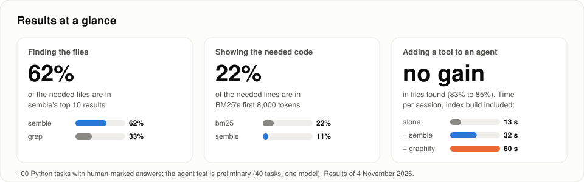
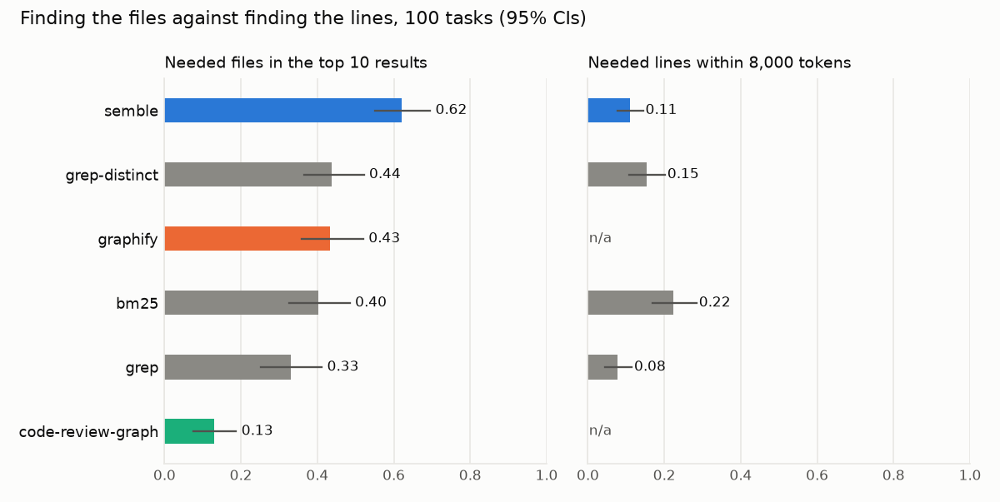
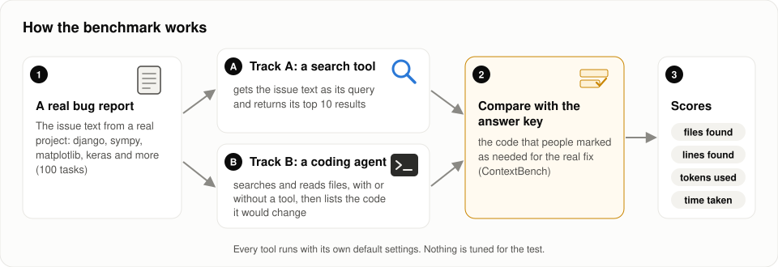

# codesearch-bench

**Do code-search tools help coding agents find the code a fix needs?** This benchmark tests
semble, graphify and code-review-graph against plain grep and BM25 on 150 real bug-fix tasks
where people marked exactly which code each fix needed. Each tool is tested as a single search,
and semble and graphify also as tools handed to a coding agent. No affiliation with any tool;
default settings; pinned versions.



## What we found

1. **Single search: semble finds the most files.** 62% of the needed files are in its top 10
   results, against 33% for grep, and it returns about 3,300 tokens instead of grep's 49,500.
2. **Exact lines for the tokens spent: BM25 is best.** Its first 8,000 tokens hold 22% of the
   needed lines; semble's 11%, grep's 8%.
3. **Large projects are hard for every tool.** On 50 tasks from 13 large projects, semble still
   leads but finds only 29% of the files.
4. **An agent gains little from the tools.** A coding agent (Claude Code, Haiku model) using
   only its own search and file reading found 46% of the needed files on the 50 hard tasks,
   more than any tool's single search. With semble it found 50% (+4 points, weak evidence);
   with graphify 44% (no gain). Each tool made a session 22 to 33% more expensive.

**In short:** a better search tool matters when one search is all you get, as in a RAG
pipeline. An agent that can grep and read files gets most of the way on its own, at least with
this model.

## Results

### Single search (100 Python tasks)

<!-- results:start (generated by `csbench report`) -->
| Tool | Files found (top 10) | Lines found (first 8k tokens) | Tokens per query |
|---|---|---|---|
| grep (ripgrep 14.1.0) | 33% | 8% | 49,546 |
| grep-distinct (ripgrep 14.1.0) | 44% | 15% | 31,653 |
| bm25 (bm25s 0.3.16) | 40% | 22% | 4,728 |
| semble (semble 0.7.2) | 62% | 11% | 3,344 |
| graphify (graphifyy 0.9.102) | 43% | n/a | 3,076 |
| code-review-graph (code-review-graph 2.3.9) | 13% | n/a | 2,199 |

Means over 100 tasks (0 failed queries). Confidence intervals and every other measure: [results/v1/summary.md](results/v1/summary.md).
<!-- results:end -->

graphify and code-review-graph point to locations instead of returning code, so lines found
does not apply to them (n/a).

<picture>
  <source media="(prefers-color-scheme: dark)" srcset="results/v1/plots/files_vs_lines_dark.png">
  
</picture>

On the 50 hard tasks (13 projects with at least 2,500 files, 4 languages, fixes touching 3 or
more files), files found drop for every tool: semble 29%, graphify 21%, BM25 18%, grep 12%,
code-review-graph 5% ([full table](results/hard/summary.md)).

### With a coding agent (50 hard tasks)

| Agent | Files found (top 10) | Found every needed file | Cost per session | Time per session |
|---|---|---|---|---|
| alone | 46% | 3 of 50 | $0.0041 | 17 s |
| + semble | 50% | 6 of 50 | $0.0054 (+33%) | 24 s |
| + graphify | 44% | 3 of 50 | $0.0050 (+22%) | 21 s |

The agent ran its tool in all 50 sessions. Each index was built before the session (semble
7 s, graphify 36 s on average) and is not in the time column. In an earlier run on 40 easier
tasks, the agent alone found 83% and neither tool changed that significantly, at 11% and 39%
more cost. Confidence intervals and paired tests: [hard run](results/trackb-hard-haiku/summary.md),
[easier run](results/trackb-haiku/summary.md).

## How it works



- **Tasks:** from [ContextBench](https://github.com/EuniAI/ContextBench), where annotators
  marked the code each real fix needed: 100 Python tasks from 10 projects, plus 50 hard tasks.
- **Single search (Track A):** each tool gets the bug report as its query and returns its top 10 results.
- **With an agent (Track B):** Claude Code reads the bug report in the repository and lists the code to
  change, with no tool, with semble or with graphify. Same prompt for all three; each tool comes
  with its own documented instructions; every session runs in a sandbox.
- **Scores:** *files found* is the share of the needed files in the top 10 results; *lines
  found* the share of the needed lines in the first 8,000 tokens; cost is tokens, dollars and
  time. Every number has a 95% confidence interval, and tools are compared with paired tests.

Exact rules, versions, settings and more charts: [docs/METHOD.md](docs/METHOD.md).

## Limits

- One agent and model (Claude Code with Haiku); other agents may use the tools better.
- It measures finding the code, not whether the agent then fixes the bug.
- The needed code is what annotators marked for one fix; other useful code can exist.
- Agent runs vary, so differences of a few points are noise.
- Tools run with default settings and the bug report as the query.

All limitations: [docs/METHOD.md](docs/METHOD.md#limitations).

## Run it

```bash
make all                            # single search, 100 Python tasks -> results/v1/
make all CONFIG=configs/hard.yaml   # single search, 50 hard tasks -> results/hard/
```

Needs [uv](https://docs.astral.sh/uv/), git and ripgrep. The agent runs also need Claude Code
signed in and bubblewrap: `uv run csbench trackb-local --trackb-run trackb-hard-haiku`, then
`uv run csbench trackb-report --trackb-run trackb-hard-haiku` (about $0.75 at list price).

**On your own project:** this turns your recent commits into tasks and runs every tool on them.
Commit messages often name the changed code, so compare the tools with each other, not with
the tables above.

```bash
uvx --from git+https://github.com/itsDigvijaysing/agent-codesearch-bench csbench try /path/to/your/repo
```

Tool maintainers can propose a configuration through a pull request
([CONTRIBUTING.md](CONTRIBUTING.md)).

## Credits and license

Gold context, task data and the line-interval metric come from ContextBench (Apache-2.0).
This repository is licensed under the [Apache License 2.0](LICENSE).
