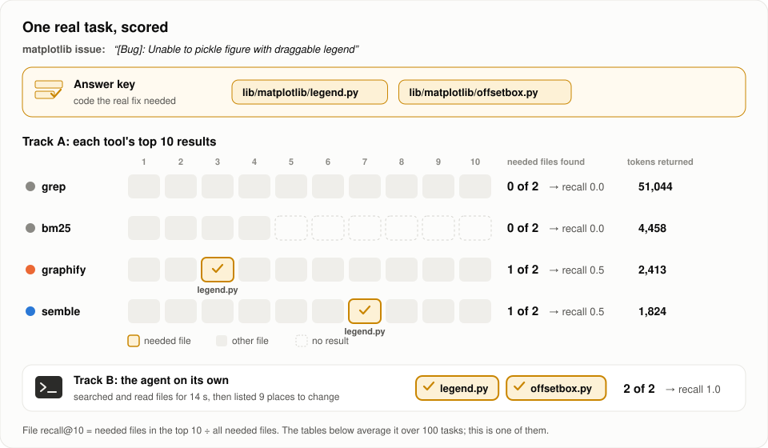
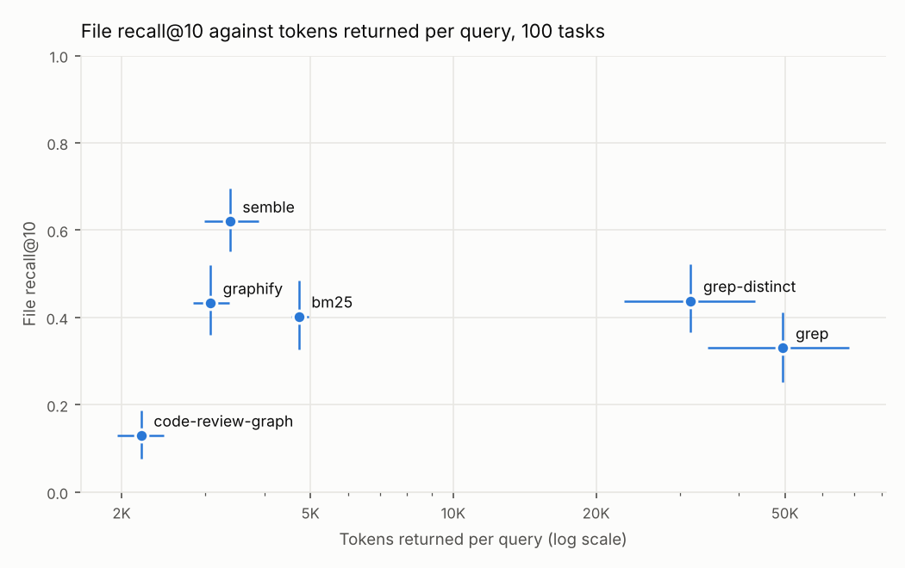
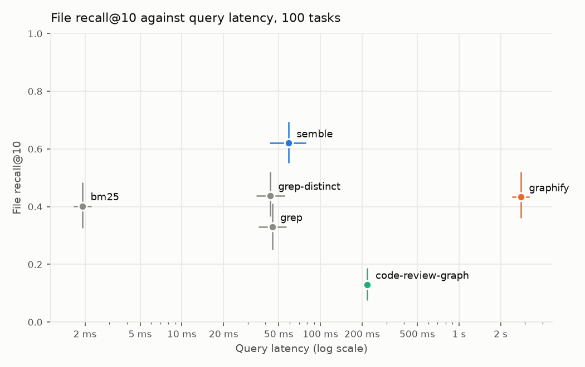
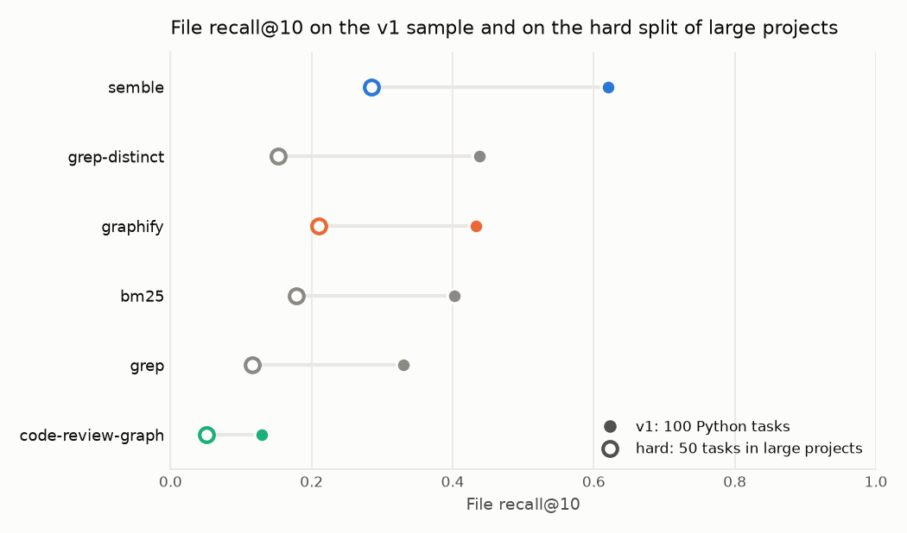
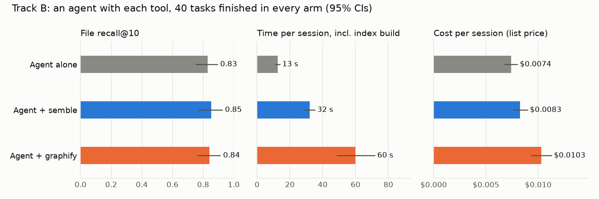

# codesearch-bench

Coding agents use search tools to find the code a task needs before they change it. This
benchmark tests those tools on 100 real bug-fix tasks where humans marked exactly which code
the fix needed, and measures two things: **does the tool find that code**, and **what does it
cost** (tokens handed to the agent, time, memory).

It is neutral: no affiliation with any tool, every tool runs with its documented interface and
default settings, and every number can be reproduced with one command.


## Key findings

Written by hand from the results of 4 November 2026; the tables further down are regenerated
when tool versions change.

1. **Finding the right files: semble is best.** In its top 10 results it finds 62% of the
   files a fix needs, against 33% for plain grep (a significant gap), while handing the agent
   about 3,300 tokens instead of grep's 49,500. graphify (43%), grep ranked by distinct terms
   (44%) and BM25 (40%) sit together. code-review-graph's default keyword search returned
   nothing for 65 of the 100 issue texts.
2. **Finding the exact lines: BM25 is best.** Reading each tool's results in order up to
   8,000 tokens, BM25 covers 22% of the needed lines, semble 11% (p < 0.01) and grep 8%.
   semble points to the right files, but its 10 short chunks show less of the needed code.
3. **Large projects are harder for every tool.** On 50 tasks from 13 large projects in 4
   languages, scores drop to between a third and a half of the main run. semble still leads
   (29%), then graphify (21%) and BM25 (18%); grep ranked by distinct terms falls from second
   to fourth (15%), and plain grep finds 12%.
4. **With an agent, the tools did not improve accuracy (preliminary, 40 tasks).** An agent
   using only its built-in search and file reading found 83% of the needed files on average,
   and all of them in 25 of 40 tasks. Search alone on the same 40 tasks found 40% with grep
   and 71% with semble. Given semble or graphify with their own instructions, the agent used them
   in 35 and 34 of 40 sessions, yet no accuracy difference reached significance (all within
   6 points, smallest p = 0.06). The tools did cost more: 11% more per session with semble
   and 39% more with graphify at list price (both significant). Sessions also took about 2.6
   and 4.8 times as long, but most of that is the tool building its index inside the session
   (graphify's graph build alone averages 38 s on these tasks), which a regular user does once.
   These 40 tasks are easy for an agent: 30 of the bug reports name a needed file, 18 tasks
   need a single file, and 25 come from SWE-bench Verified, which the model may have seen in
   training.
5. **What it means:** a better search tool matters most when one search is all you get (a
   single retrieval step, a RAG pipeline). An agent that can grep and read files recovered
   most of the gap on these mostly easy tasks, at least with this model (Claude Haiku).
   Whether that holds for larger, multi-file tasks is still open; the hard split is the next
   test.

## How to read the numbers

Here is one of the 100 tasks, scored the way every task is:



The tables and charts use these measures:

- **Gold context** (the answer key in the figure): the code that human annotators marked as
  needed for the fix ([ContextBench](https://github.com/EuniAI/ContextBench)). Every score compares a tool's
  results with it.
- **File recall@10:** of the files the fix needs, the share that appear in the tool's first
  10 results. 1.0 means all of them.
- **MRR:** how high the first needed file ranks (1.0 means it is always first, 0.5 second).
- **Line recall @ 8k tokens:** read the tool's results in order until 8,000 tokens are used;
  the share of the needed lines that were in that text. This compares tools at equal cost.
- **Tokens returned:** how much text the tool hands the agent per query. More tokens means
  more cost and more of the agent's context used up.
- **[low, high]:** 95% confidence interval over tasks. When two tools' intervals overlap a
  lot, the difference may be noise; the paired tests in `results/<run>/paired_vs_grep.csv`
  settle it.

## Why this exists

Users of these tools keep asking for independent numbers, and tool authors have said there is
no good benchmark to compare against. See the discussions in the r/ClaudeAI launch threads for
[graphify](https://www.reddit.com/r/ClaudeAI/comments/1ui6unv) and
[semble](https://www.reddit.com/r/ClaudeAI/comments/1szvo7t).

Tuned settings, if any, are labelled separately from defaults. Maintainers can propose a
configuration for their tool through a pull request (see [CONTRIBUTING.md](CONTRIBUTING.md)).

## Results

Colors are the same in every chart: gray for the baselines (grep, grep-distinct, BM25 and the
agent on its own), blue for semble, orange for graphify, aqua for code-review-graph.

### Track A: search only (100 Python tasks)

Each tool gets the issue text as its query and returns its top 10 results.

<!-- results:start (generated by `csbench report`) -->
| Tool | File recall@10 | MRR | Line recall @ 8k tokens | Tokens returned | Failures |
|---|---|---|---|---|---|
| grep (ripgrep 14.1.0) | 0.330 [0.251, 0.412] | 0.260 [0.192, 0.332] | 0.077 [0.045, 0.115] | 49,546 | 0/100 |
| grep-distinct (ripgrep 14.1.0) | 0.438 [0.366, 0.522] | 0.433 [0.348, 0.520] | 0.154 [0.109, 0.202] | 31,653 | 0/100 |
| bm25 (bm25s 0.3.16) | 0.402 [0.327, 0.485] | 0.400 [0.327, 0.481] | 0.224 [0.169, 0.285] | 4,728 | 0/100 |
| semble (semble 0.7.2) | 0.620 [0.551, 0.695] | 0.588 [0.508, 0.665] | 0.110 [0.077, 0.145] | 3,344 | 0/100 |
| graphify (graphifyy 0.9.102) | 0.433 [0.360, 0.520] | 0.397 [0.324, 0.479] | n/a | 3,076 | 0/100 |
| code-review-graph (code-review-graph 2.3.9) | 0.130 [0.075, 0.188] | 0.145 [0.082, 0.213] | n/a | 2,199 | 0/100 |

Means over 100 tasks with 95% bootstrap confidence intervals (B = 1000, seed 42). Full table: [results/v1/summary.md](results/v1/summary.md).
<!-- results:end -->

graphify and code-review-graph return locations rather than code, so line recall at a token
budget does not apply to them (n/a). Query time, index build time, index size and memory are
in the full table.

The same 100 tasks, files against lines (bars are means, whiskers 95% confidence intervals):

<picture>
  <source media="(prefers-color-scheme: dark)" srcset="results/v1/plots/files_vs_lines_dark.png">
  
</picture>

Recall against cost:

<picture>
  <source media="(prefers-color-scheme: dark)" srcset="results/v1/plots/recall_vs_tokens_dark.png">
  
</picture>
<picture>
  <source media="(prefers-color-scheme: dark)" srcset="results/v1/plots/recall_vs_latency_dark.png">
  
</picture>

Query latency excludes index build time.

### Hard split: large projects (50 tasks, 4 languages)

Tasks from 13 projects with at least 2,500 files, where the fix needs code in 3 or more files.
File recall@10: semble 0.285, graphify 0.211, BM25 0.178, grep-distinct 0.153, grep 0.116,
code-review-graph 0.051. Full table with confidence intervals:
[results/hard/summary.md](results/hard/summary.md).

<picture>
  <source media="(prefers-color-scheme: dark)" srcset="results/plots/v1_vs_hard_dark.png">
  
</picture>

### Track B: an agent with each tool (preliminary, 40 tasks)

A coding agent (Claude Code, Haiku model) reads the issue in the repository and lists the code
to read or change. The arms differ only in which tool, if any, it is given. Full table with
confidence intervals and paired tests:
[results/trackb-haiku/summary.md](results/trackb-haiku/summary.md).

| Arm | Used the tool | File recall@10 | Found every needed file | Cost per session | Time per session (incl. index build) |
|---|---|---|---|---|---|
| Agent alone | not recorded | 0.830 | 25/40 | $0.0074 | 13 s |
| Agent + semble | 35/40 | 0.853 | 29/40 | $0.0083 (+11%) | 32 s |
| Agent + graphify | 34/40 | 0.842 | 27/40 | $0.0103 (+39%) | 60 s |

<picture>
  <source media="(prefers-color-scheme: dark)" srcset="results/plots/trackb_dark.png">
  
</picture>

The run stopped at an account usage limit after 40 to 50 tasks per arm; these are the 40 tasks
finished in every arm. Cost is the session's own list-price cost; token counts are in the
full table but are 92% cached reads, which cost a tenth of fresh input. The tool's index is
built inside each session (graphify by a setup command, semble on its first search), so the
time column includes it; the search-only test measured the build at 38 s for graphify and 6 s
for semble on these tasks. Two graphify sessions resumed after the limit and their time counts
only the resumed part (without them graphify takes 4.9 times as long). The planned Sonnet
subset was not run.

## Try it on your project

Which tool works best on *your* code? One command mines tasks from your repository's git
history and runs every tool on them:

```bash
uvx --from git+https://github.com/itsDigvijaysing/agent-codesearch-bench csbench try /path/to/your/repo
```

(or `make try REPO=/path/to/your/repo` from a checkout). It needs [uv](https://docs.astral.sh/uv/),
git and ripgrep, and writes the same report as above to `./csbench-try-<name>/`.

How it works: each recent focused commit (1 to 5 non-test files changed; version bumps,
merges, reverts and formatting skipped) becomes a task. The commit message is the query, the
lines it changed are the answer, and every tool searches the commit before it. Commit messages
are written after the fix and often name the changed code, so scores run high: compare the
tools with each other, not with the tables above. Options: `--commits N` (default 20),
`--tools grep bm25 semble`, `--time-budget-min M` (stop and resume later). The rule is in
[`src/csbench/tryrepo.py`](src/csbench/tryrepo.py).

## Method

**Dataset.** [ContextBench](https://github.com/EuniAI/ContextBench) (Apache-2.0,
[arXiv 2602.05892](https://arxiv.org/abs/2602.05892)), Hugging Face dataset
[`Contextbench/ContextBench`](https://huggingface.co/datasets/Contextbench/ContextBench),
config `contextbench_verified` (500 tasks with human-annotated gold context), pinned to
revision `c2855792b006af41c67202d33883fb9d46362853`. Gold context is a list of
`{file, start_line, end_line}` spans.

**v1 sample** ([`data/sample_v1.txt`](data/sample_v1.txt), rule in
[`src/csbench/sample.py`](src/csbench/sample.py)): Python tasks only; the 10 repositories
with the most Python tasks (ties by name); 100 tasks spread across them by water-filling
(equal quota per repository, repositories with fewer tasks give all of theirs, leftover seats
drawn with `random.Random(0)`); tasks inside each repository drawn with the same generator; the
list is then shuffled, so any prefix is also a seeded random subset. Result: django,
transformers, scikit-learn and matplotlib 10 each; sympy, ansible, sphinx and keras 11 each;
xarray and openlibrary 8 each.

**Hard split** ([`data/sample_hard.txt`](data/sample_hard.txt),
[`configs/hard.yaml`](configs/hard.yaml), rule `select_hard` in
[`src/csbench/sample.py`](src/csbench/sample.py)): 50 tasks in any language, not in the v1
sample, whose gold context spans at least 3 files, from repositories with at least 2,500
tracked files at the base commit, at most 5 per repository (seed 0). That selects 13 large
projects in Python, JavaScript, TypeScript and Java: django, ansible, transformers, langchain,
matplotlib, svelte, prettier, material-ui (two repository names), NodeBB, element-web, vscode
and logstash. Run it with `make all CONFIG=configs/hard.yaml`.

**Input.** Each tool gets the task's issue text (problem statement) as the query, with the
repository checked out at the task's base commit. Every gold file of the 100 sample tasks
exists at its base commit (299 of 299 files checked), so a perfect tool can reach recall 1.
Each tool is asked for its top 10 results in its own unit (files, chunks or code entities).

**Track A: search only.** Each tool returns ranked context (files and, where available,
line spans), which is scored against the gold context.

**Track B: an agent with each tool** ([`configs/trackb.yaml`](configs/trackb.yaml),
[`src/csbench/trackb.py`](src/csbench/trackb.py)). A coding agent (Claude Code in a cloud
session, Haiku model) gets the same issue at the base commit and must name the code to read or
change, ending with a JSON list of locations. Every arm gets the same prompt; the tool arms add
one setup line and the tool's own documented agent instructions, given as project
instructions (CLAUDE.md) at the top of the prompt. For graphify that is the CLAUDE.md block its
installer writes; for semble it is its Claude Code sub-agent text, verbatim (semble's own
install adds it as a sub-agent, not as project instructions). The final locations are scored
with the Track A metrics; cost is the session's own token count, turns, time and list-price
cost. Web search and fetch are forbidden in the prompt and their use is counted (0 in every
session). For the tool arms, whether the agent actually ran the tool is recorded. All tools
are preinstalled for every arm by the cloud environment's setup script, so every arm runs on
the same machine image.

**Baselines.**
- *grep*: identifiers extracted from the issue text (file paths, dotted names, CamelCase and
  camelCase, snake_case, quoted strings of 3 to 80 characters; at most 64 terms; URLs, web
  domains, abbreviations such as "e.g" and single quoted English words are dropped) searched
  with ripgrep as fixed strings in one pass. Files are ranked by total hit count (ties: distinct
  terms matched, then path). Each file returns its hit lines with 3 lines of context. The rule
  is documented in [`adapters/grep.py`](src/csbench/adapters/grep.py).
- *grep-distinct*: the same terms and ripgrep pass, but files are ranked by the number of
  distinct terms matched first, then hit count. Ranking by raw hit count favours large test
  files and changelogs, so both rankings are reported; paired comparisons use the hit-count
  `grep` as the baseline.
- *BM25*: [bm25s](https://github.com/xhluca/bm25s) (Lucene variant, k1 = 1.5, b = 0.75) over
  50-line chunks of git-tracked text files up to 1 MB; code-aware tokenizer (snake_case and
  camelCase split, lowercased). See [`adapters/bm25.py`](src/csbench/adapters/bm25.py).

**Tools under test** (exact versions and settings in [`configs/tools.yaml`](configs/tools.yaml)).
Each runs through its documented interface with default settings, in its own virtual
environment installed from a committed, hashed lock file (`configs/envs/<tool>.txt`), so every
tool gets the dependency versions its own users get. Everything runs on CPU without network
access at query time and without any LLM call.
- *semble*: Python API, `SembleIndex.from_path(repo)` then `search(query, top_k=10)`; its
  default embedding model (`minishlab/potion-code-16M-v2`) pinned to a Hugging Face revision.
  Returns code chunks.
- *graphify*: `graphify extract <repo> --code-only` with `GRAPHIFY_BACKEND=none` (tree-sitter
  AST, all LLM backends disabled), then `graphify query "<issue>"` with defaults (depth 2,
  2,000-token budget; graphify sizes answers by tokens, not by a result count). Returns graph
  nodes with a file and a start line.
- *code-review-graph*: `code-review-graph build`, then `code-review-graph search "<issue>"
  --limit 10`; without an embedding provider configured (the default) search is keyword
  full-text search. Returns code entities with a file and a line range.

graphify and code-review-graph return locations rather than code. They are scored on what they
return: file metrics from the order of their results, span metrics where they give line ranges
(code-review-graph), and tokens returned as the size of their own output, which is what the
agent receives. Token-budget recall is not applicable to them.

**Metrics per (tool, task).** Ranked files are the distinct files of the results in order.
- File recall@1/5/10, file precision@5/10 (divided by k), MRR of the first gold file.
- Span recall and precision: line-level overlap of the union of returned spans with the gold
  lines, using ContextBench's line-interval metric (ported in
  [`intervals.py`](src/csbench/intervals.py)). One deviation: an empty result has precision
  0, not 1.
- Tokens returned: the returned lines, read from the checkout, counted with tiktoken
  `o200k_base` (tool formatting overhead is excluded). A whole-file result counts the whole
  file. For tools that return locations, the tokens of the tool's own output.
- Empty results: successful queries that returned nothing (reported, scored as zero recall).
- Line recall at 2,000 and 8,000 tokens: gold-line recall of the results taken in rank order
  until the budget is used; the result that crosses the budget keeps its leading lines.
- Query latency, index build time, index size on disk, and peak RSS (maximum over the worker
  process and its child processes). Each (tool, task) runs in a fresh worker process on CPU.

**Statistics.** Means with 95% percentile bootstrap confidence intervals over tasks
(B = 1000, seed 42), and a paired bootstrap of each tool against the grep baseline
(`results/<run>/paired_vs_grep.csv`). Failed tasks are never dropped: they score zero on every
quality metric and the failure rate is reported. Cost metrics are over successful tasks.

## Reproduce

Requires [uv](https://docs.astral.sh/uv/), git and ripgrep. One command recomputes every
number from scratch:

```bash
make all
```

This is `uv run csbench all --fresh --config configs/v1.yaml`: it downloads the pinned
dataset, checks out each task's repository (blobless clone plus a worktree), runs every active
tool, and writes `results/v1/`, including the table above. It ignores the committed records,
so the output can be compared with what is committed. Interrupted runs resume where they
stopped. Versions are pinned in `uv.lock` (the benchmark and its baselines),
[`configs/tools.yaml`](configs/tools.yaml) and the per-tool lock files in
[`configs/envs/`](configs/envs); tool environments are created automatically under `.cache/`.

[`scripts/weekly.sh`](scripts/weekly.sh) upgrades the tools under test to their latest
releases (`csbench upgrade`), recomputes only what changed, and commits the new results. The
grep and BM25 baselines stay fixed so the reference point does not move.

Per-task records are committed in `results/v1/per_task/<tool>.jsonl.gz`. Each record carries
a fingerprint of the tool settings, metric settings, dataset revision, the tool's lock file and
the adapter and metric source code; `uv run csbench run` (without `--fresh`) reuses a committed
record only when its fingerprint still matches.

## Tools

| Tool | Status |
|---|---|
| grep, grep-distinct and BM25 baselines | in v1 |
| [semble](https://github.com/MinishLab/semble) | in v1 and Track B |
| [graphify](https://github.com/Graphify-Labs/graphify) | in v1 (deterministic AST code mode only) and Track B |
| [code-review-graph](https://github.com/tirth8205/code-review-graph) | in v1, keyword search (no embeddings, no LLM) |
| [Serena](https://github.com/oraios/serena) | not yet: agent-driven symbolic navigation, not free-text search, so it only fits Track B |
| [claude-context](https://github.com/zilliztech/claude-context) | v2: needs a Milvus instance and an embedding API key |

## Limitations

- Gold context is what human annotators judged necessary for one fix; other relevant code
  can exist, so precision is a lower bound.
- The issue text is used verbatim as a single query. Agents usually issue several, refined
  queries; Track B covers that.
- The v1 sample is Python only, from 10 repositories.
- Tokens count returned code only, not each tool's output formatting (except for the
  location tools, whose output is counted).
- code-review-graph's keyword search returned nothing for 65 of the 100 issue texts (it finds
  results for short queries); the benchmark keeps each tool's default behaviour with the issue
  text as the query, so this counts against it. Agents that write short queries (Track B) may
  see different results.
- semble returns about 3,300 tokens for its top 10 chunks, so its line recall at 8,000 tokens
  equals its span recall; ranking more chunks would cost more tokens and could recall more.
- Query latency is measured inside one process per (tool, task): an in-process API call for
  BM25 and semble, a CLI process (including its start-up) for grep, graphify and
  code-review-graph. Peak RSS includes the benchmark's worker process (about 20 MiB).
- The grep baseline returns every hit line (with context) of its top 10 files, so its token
  count is far higher than an agent that lists matching files first and then reads a few. The
  token-budget recall columns compare tools at equal token cost.
- Track B is preliminary: 40 tasks, one model (Haiku), one session per task and arm (agent
  runs are not deterministic), localization only (no patch or tests). With 40 tasks, accuracy
  differences smaller than about 5 points cannot be told apart from noise.
- Track B's 40 tasks may overstate what an agent does alone: most bug reports name a needed
  file, and 25 of the 40 come from SWE-bench Verified, whose fixes are public and may be in the
  model's training data. The hard split draws mostly on newer sources (SWE-bench Pro,
  Multi-SWE-bench, SWE-PolyBench).
- Track B tool calls were collected for the semble and graphify arms only. The tools were
  installed in every arm's environment and the baseline prompt never mentions them, but
  whether a baseline agent ever ran one is not recorded.
- In Track B, one semble session hit a Hugging Face download limit while fetching semble's
  model (25 sessions started at once); which one is not recorded, so "used the tool" may
  count one session where semble did not return results.
- Track B runs in Claude Code cloud sessions, which change between versions, so the protocol
  and per-session records are committed but the sessions cannot be replayed exactly.
- code-review-graph and Serena are not Track B arms: their documented agent integration is an
  MCP server, which a cloud session cannot have configured before it starts without also
  exposing it to the baseline arm.

## Credits and license

Gold context, task data and the line-interval metric come from ContextBench (Apache-2.0).
This repository is licensed under the [Apache License 2.0](LICENSE).
